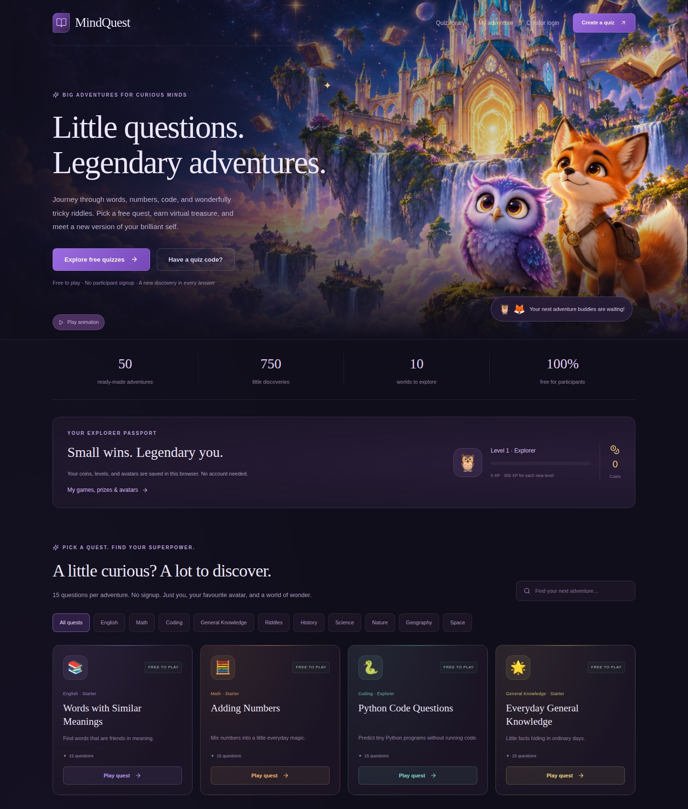

  

<h1 align="center">MindQuest</h1>

Learn. Play. Level up. A little adventure for curious minds.

<a href="https://mind-quest-henna.vercel.app/"><strong>✨ Play MindQuest →</strong></a>

## ✨ Features

- 📚 **A world of quizzes** — 50 free quizzes, 750 questions and 10 topics to explore on the homepage or in the quiz library.
- 🦊 **Pick a buddy & play** — enter a nickname, choose an avatar and jump straight into a quiz. No player signup needed.
- ⏱️ **Learn through play** — timed questions, playful animations, sound effects and friendly answer explanations.
- 🏆 **Celebrate every finish** — instant result popups, saved result pages and quiz scoreboards with player names, scores and levels.
- 💎 **Grow your adventure** — collect XP, virtual coins, levels, unlockable avatars and mastery trophies for scores above 90%.
- ✍️ **Create & share** — publish your own quizzes, share join codes and follow participant results from your creator dashboard.
- 📱 **Play anywhere** — responsive screens, animated loading states and support for reduced motion.

Guest progress stays in the same browser. Scoreboards show nicknames, best scores and levels. All rewards are virtual.

## 🛠️ Built with

Next.js 16 · React 19 · TypeScript · Tailwind CSS · Prisma 7 · Neon PostgreSQL · Better Auth

---

[Setup & deployment](docs/deployment.md) · [Architecture](ARCHITECTURE.md) · [Feature checklist](FEATURE_CHECKLIST.md)
